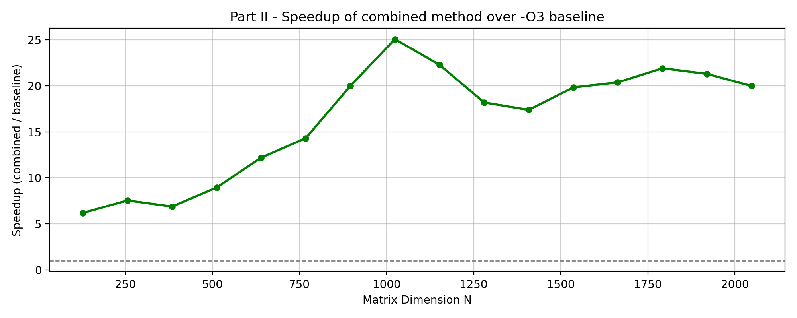

<!-- Repo description: "Matrix multiplication in C with OpenMP, AVX2 and cache tiling: up to 25× faster than -O3"
     Topics: c, high-performance-computing, openmp, simd, avx2, performance, profiling
     Facts from this repo's report.tex / Final report and profile.md. -->

# Optimisation of Matrix Multiplication (C, OpenMP, AVX2)

Six selectable implementations of double-precision matrix multiplication, a profiling harness, and an analysis of
why each optimisation helps on real hardware. **The combined kernel reaches up to 25× the throughput of the
compiler-optimised (`-O3`) baseline** (about 6× at N = 128, peaking at N = 1,024).



## Implementations (`main.c`)

| Method | ID | Idea |
|---|---|---|
| Baseline | 0 | Triple loop |
| Loop-unrolled | 1 | Unrolls the inner loop (`UNROLL`) |
| Multi-threaded | 2 | OpenMP across rows |
| Cache-tiled | 3 | Multiplies blocks that fit in cache (`BLOCK_SIZE`) |
| Vectorised | 4 | AVX2 intrinsics: 4 doubles per instruction, 32-byte aligned memory |
| Combined | 5 | Tiling + AVX2 + OpenMP with dynamic scheduling, plus a scalar loop for leftover columns |

## What the profiling showed (Intel i7-1355U: 10 cores / 12 threads, 12 MiB L3)

- **The cache matters most.** Three N × N matrices of doubles fit in the 12 MiB L3 only up to N ≈ 707. Beyond that the
  baseline's throughput falls, because its inner loop walks down a column of B and misses the cache.
- **Threads scale until the physical cores run out.** Scaling is near-linear up to about 10 threads, then flattens:
  two hyper-threads on one core compete for the same floating-point units.
- **The combined kernel holds its throughput at large N**, because tiling keeps the working set in cache, so the SIMD
  units aren't stalled on memory.

The graphs for every experiment (compiler flags, unroll factors, 1–12 threads, tile sizes, SIMD) are in `graphs/`;
the full write-up is `report.pdf`.

## Build and run

```bash
make OPT=-O3                                    # builds matrix_multiply.out (and main.s, the generated assembly)
./matrix_multiply.out <L> <M> <N> <seed> <method>   # method 0–5, as above
python3 profile_2.py                            # rebuilds, averages 3 runs per size, writes graphs/
```

## What I wrote

All six implementations, the aligned-memory and leftover-column handling, and the profiling scripts and analysis.
Built for COMP25212 (System Architecture), University of Manchester, May 2026.
